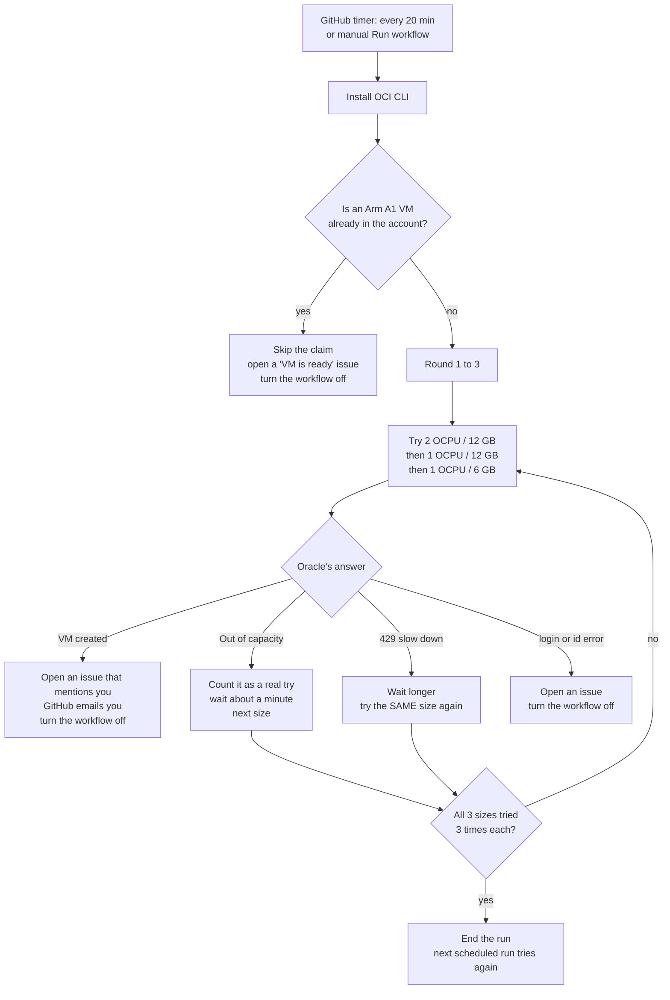

# oracle-free-vm-claim

Keeps asking Oracle Cloud for a free **Always Free Arm (A1) VM** until Oracle has room, then tells you and stops.

Oracle's free Arm servers in busy regions are usually full ("Out of host capacity"). Capacity frees up now and then, so this repo asks again and again from GitHub Actions. You do not need to keep a laptop on.

- Region: `ap-hyderabad-1` (India South, Hyderabad)
- Server name: `forever-free`
- Sizes it tries, in order: **2 OCPU / 12 GB**, then **1 OCPU / 12 GB**, then **1 OCPU / 6 GB** (each with a 150 GB boot disk)

---

## When it runs (automatic)

The workflow runs **by itself, every 20 minutes, all day and night**. You do not need to click anything.

GitHub reads schedules in **UTC**. India (IST) is UTC + 5:30. So the runs are at these times:

| Every hour at (UTC) | Every hour at (IST) |
|---|---|
| :07 | **:37** |
| :27 | **:57** |
| :47 | **:17** |

Example in IST: 19:17, 19:37, 19:57, 20:17, 20:37, 20:57, and so on.

Things to know:

- GitHub often starts scheduled runs **5 to 15 minutes late** when it is busy. A late or skipped slot is normal.
- One run takes about **8 minutes** and stops by itself at **10 minutes**. The next one starts later, so runs never overlap.
- GitHub **pauses scheduled runs after 60 days with no activity** in a public repo. If that happens, open the Actions tab and click the enable button, or push any small commit.
- The schedule lives in [`.github/workflows/try.yml`](.github/workflows/try.yml) (`cron: "7,27,47 * * * *"`). GitHub runs schedules only from the **`main`** branch.

---

## Run it by hand (manual trigger)

Use this to test, or to try right now without waiting.

1. Open the repo on GitHub and sign in.
2. Click the **Actions** tab.
3. On the left, click **claim-oracle-vm**.
   (If GitHub shows a green **I understand my workflows, go ahead and enable them** button, click it first.)
4. Above the list of runs, click the **Run workflow** drop-down on the right.
5. Keep **Branch: main** selected, then click the green **Run workflow** button.
6. Wait a few seconds and reload. A new row appears with a yellow circle (running).
7. Click the row, then the **Summary** page to read the result.

Command line option (needs the `gh` tool):

```bash
gh workflow run claim-oracle-vm --repo <owner>/oracle-free-vm-claim
gh run list --repo <owner>/oracle-free-vm-claim --limit 5
```

---

## How it works (the flow)



Step by step:

1. **Check first.** The script lists the Arm (A1) VMs in the account, under any name. If one is not being deleted, it makes **no launch request** and stops.
2. **Request.** If none exists, it asks for each of the three sizes in turn, and repeats the whole list **3 times**. So every size gets **3 real tries** per run.
3. **A "real try"** is any answer where Oracle looked at the request: "no capacity" counts.
4. **"Slow down" (HTTP 429) is not a try.** The script waits longer (about 100 s, then 150 s, then 180 s) and asks for the **same size** again. After 4 slow-downs in a row it gives up on that one try and moves on.
5. **Pacing.** Tries are about a minute apart. Oracle rate-limited launches that were about 25 seconds apart, so the gap is kept near a minute.
6. **Time limit.** A run ends politely after about 10 minutes, even if it is not finished. The next run continues.
7. **Success.** When a VM is created, the workflow opens a GitHub issue that mentions and assigns the repo owner. GitHub emails that. The workflow then **disables itself**, so it stops trying.

The logic is in [`try.sh`](try.sh). The timer and the notify steps are in [`.github/workflows/try.yml`](.github/workflows/try.yml).

---

## Reading the result

Open a run, then the **Summary** page. It shows a headline, counts, and one row per try. The full log is under the **try** job, in the step **Try to claim the VM**.

| Result code | Meaning | What to do |
|---|---|---|
| `created` | VM made | Check your email and the Oracle console |
| `exists` | An Arm VM already exists | Nothing. The workflow turns itself off |
| `retry` | No capacity right now | Nothing. The timer tries again |
| `fatal` | Oracle rejected the login, an id, or a limit | Fix the secret named in the log. The workflow is off until you re-enable it |
| `error` | An error the script does not know | Read the log (the raw error is folded in a group) |

Log symbols: `⏳` no capacity, `🚦` Oracle says slow down, `✅` success, `❌` stopped, `❓` unknown.

---

## One-time setup

### 1. Oracle API key

In the Oracle console: profile icon, **My profile**, **API keys**, **Add API key**, **Generate API key pair**. Download the **private** key (`.pem`). Oracle then shows `user`, `tenancy`, `fingerprint` and `region`.

### 2. SSH key (to log in to the new server)

```bash
ssh-keygen -t rsa -b 4096 -f ~/.ssh/oracle_free -C "oracle-free"
```

Only the **public** file (`oracle_free.pub`) goes to GitHub. Keep the private file on your computer.

### 3. GitHub secrets

Go to **Settings, Secrets and variables, Actions** and add these repository secrets:

| Secret | What it is | Where to get it |
|---|---|---|
| `OCI_CLI_USER` | Your user OCID | Oracle's API key box (`user=`) |
| `OCI_CLI_TENANCY` | Tenancy OCID | Oracle's API key box (`tenancy=`) |
| `OCI_CLI_FINGERPRINT` | Key fingerprint | Oracle's API key box (`fingerprint=`) |
| `OCI_CLI_REGION` | `ap-hyderabad-1` | Oracle's API key box (`region=`) |
| `OCI_CLI_KEY_CONTENT` | **Private** API key, full text of the `.pem` | The file you downloaded |
| `SSH_PUB` | Your **public** SSH key, one line | `~/.ssh/oracle_free.pub` |
| `C` | Compartment OCID (the root compartment equals the tenancy OCID) | Same as the tenancy OCID |
| `AD` | Availability domain name | Oracle's "Create instance" page, under Placement |
| `SUBNET` | OCID of `public-subnet` | Networking, VCN, Subnets, Copy OCID |
| `IMAGE` | OCID of an **aarch64** Ubuntu image for the region | Oracle's image documentation page |

Set a file-based secret without showing it on screen:

```bash
gh secret set OCI_CLI_KEY_CONTENT --repo <owner>/oracle-free-vm-claim < path/to/key.pem
gh secret set SSH_PUB --repo <owner>/oracle-free-vm-claim < ~/.ssh/oracle_free.pub
```

Check the names (values stay hidden):

```bash
gh secret list --repo <owner>/oracle-free-vm-claim
```

### 4. Public repo

Keep the repo **public**. Public repos get unlimited free Actions minutes. A private repo would run out of free minutes in about a week.

---

## After the VM exists

1. Open the Oracle console, **Compute, Instances**, and copy the public IP.
2. Log in:

```bash
ssh -i ~/.ssh/oracle_free ubuntu@<public-ip>
```

3. The workflow turned itself off. If you ever want it to run again, open **Actions, claim-oracle-vm**, and click **Enable workflow**.
4. If you got a smaller size than you wanted, you can resize the instance in the Oracle console, up to the free limit of 4 OCPU and 24 GB.

---

## Safety notes

- **Never commit** the `.pem` private key or any password. The workflow reads them only from GitHub secrets. Secrets are encrypted, and GitHub hides them in logs.
- The Oracle user behind the API key should have only the rights it needs (compute and network in your compartment).
- Only one run is active at a time (`concurrency`), so the script never launches two servers at once.
- This repo exists only to claim one Oracle VM. It turns itself off when it is done.

## Files

| File | Purpose |
|---|---|
| `.github/workflows/try.yml` | The timer, the manual button, the notify and turn-off steps |
| `try.sh` | The check, the three sizes, the error handling, the logs and the summary |
